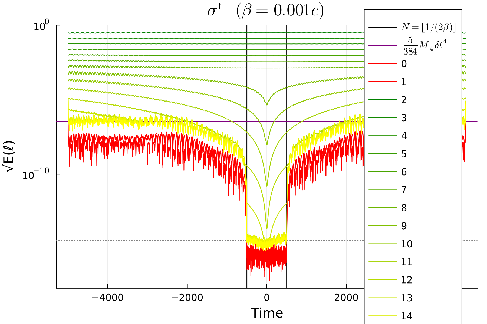
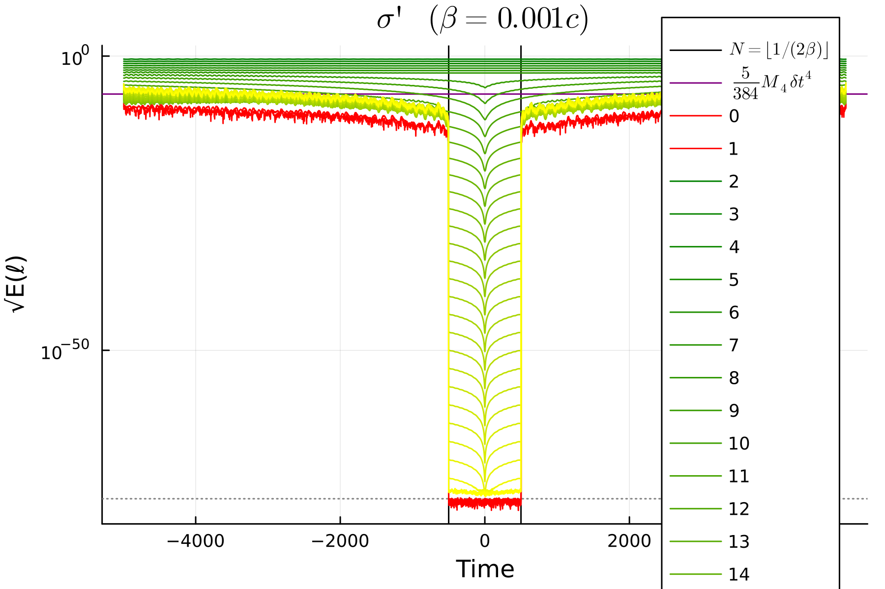

# Spline Errors

Given tabulated gravitational-wave data sampled at discrete retarded
times, BMS transformations (other than simple time shifts or
rotations) involve changing time slices, thus requiring interpolation
to evaluate the waveform in a given direction at the appropriate time.
But if the interpolation is not globally smooth, the resulting
function on the sphere will have a *spatial* discontinuity at some
finite order of tangential derivative, which in turn causes the SWSH
expansion to converge only algebraically, with a persistent power-law
floor in the truncation error as ``ℓ_\text{max}' → ∞``.  Here, we
quantify this effect for B-spline interpolation, which is commonly
used in numerical-relativity waveforms.

A B-spline of order ``n`` (polynomial degree ``n-1``, so the familiar
cubic spline is order 4) achieves ``C^{n-2}`` continuity *at* knots,
and ``C^∞`` continuity *between* knots, with interpolation error
bounded by ``O(Mₙ (δt)^n)`` where ``Mₙ = \max|H⁽ⁿ⁾|`` is the largest
magnitude of the ``n``-th derivative of the function being
interpolated [Schumaker_2007, Unser_1993](@cite).

Within any single spline interval all sky directions ``k̂`` require
rest-frame times from that same cubic (or degree-``(n{-}1)``)
polynomial, so the function ``f(k̂) = H_\text{spline}\left(t'
κ^{-1}(k̂)\right)`` on the sphere is a polynomial composed with the
smooth Doppler factor ``κ^{-1}(k̂)``, hence analytic, and its SWSH
expansion converges exponentially.  Once different sky directions
require times from different spline intervals, however, the angular
function acquires a ``C^{n-2}`` kink — a jump in the ``(n-1)``-th
tangential derivative — along the level-set curve ``{t' κ^{-1}(k̂) =
t_k}`` on ``S²``.  For a boost of speed ``β`` this transition first
occurs when ``2β|t'| > δt``, i.e., after only ``N_\text{good} ≈ ⌊
1/(2β) ⌋`` time steps from the retarded-time origin.  An additional
supertranslation of peak-to-peak amplitude ``Δα`` reduces this to
``N_\text{good} ≈ \max(0, ⌊ (1 - Δα/δt)/(2β) ⌋)``.

It's worth pausing for a moment to remark on this unusual relation:
for a simple boost, the *number of time steps away from ``t=0``* that
can be accurately represented is determined by the boost.  This is a
discrete number being given by a continuous parameter, and is
independent of the coarseness of the time sampling.  The really
remarkable thing is how precisely this relation is borne out in
practice, with a discontinuous jump in the error at the predicted time
step, regardless of the characteristics of the system being
transformed.  This number is further reduced by any supertranslation,
in a way that *does* depend on the time sampling.

The spectral consequences of the kink follow from the same argument as
for Fourier series.  A function on ``S²`` whose ``p``-th derivative is
discontinuous along a curve[^curve] has energy spectrum ``E(ℓ) ∼
ℓ^{-2(p+1)}``, where energy is defined as the sum of the squares of
the SWSH coefficients at each ``ℓ``:

```math
E(ℓ) = \sum_{m=-ℓ}^ℓ |f_{ℓm}|^2.
```

This is the result of [Livermore_2012](@citet).  The "energy spectrum"
there is the square root of ours, so the law ``ℓ^{-(p+1)}`` found
there is our ``E(ℓ) ∼ ℓ^{-2(p+1)}``.  For an order-``n`` B-spline the
jump is in the ``(n-1)``-th derivative, giving

```math
E(ℓ) ∼ ℓ^{-2n},
```

which is ``E(ℓ) ∼ ℓ^{-8}`` for cubic splines (``n = 4``).

This tail decays quickly, and it is *not* what limits the accuracy in
practice.  The limit is the size of the interpolation error itself.
Once the kinks appear, the high-``ℓ`` modes no longer converge to
roundoff, but stop at a floor comparable to the pointwise error of the
spline, which for a cubic spline is at most ``(5/384) M₄ (δt)^4``
[HallMeyer_1976](@cite).[^ends]  This floor can't be beaten by raising
``ℓ_\text{max}'`` or even by raising the precision of the number type
used in the calculation; it behaves like the persistent error of the
Gibbs phenomenon [GottliebShu_1997](@cite).  Using higher-order
splines lowers the floor as ``Mₙ(δt)^n``, but convergence requires
``ω_\text{max}\,δ t < 1`` (all frequencies sampled above Nyquist), and
for numerical-relativity waveforms the effective upper frequency is
close to Nyquist, limiting practical improvement.

[^curve]: That is, the set of points at which the function is
    discontinuous form a curve — rather than being at an isolated
    point, for example.  The kinks here lie along curves on the
    sphere.  A discontinuity at a single point would give a faster
    decay, ``E(ℓ) ∼ ℓ^{-(2p+3)}``, in the notation used here
    [Livermore_2012](@cite).

[^ends]: Strictly, the bound of Hall and Meyer is for a spline that
    matches the function's slope, or its second derivative, at the
    ends of the interval.  The natural spline used here sets the
    second derivative to zero at the ends instead, which adds an error
    there that dies away within a few intervals.

It is possible to test exponential convergence by using a globally
smooth interpolant, such as a Chebyshev expansion, which is not
piecewise-defined and thus has no knots.  In fact, this has actually
been done using a much older version of this code, obtaining
exponential convergence throughout the entire time domain.  However,
Chebyshev expansions are not well suited to tabulated data because
between the data points they can have large and unphysical
oscillations.  The constructed functions are better thought of as
*representative* of gravitational waveforms exclusively for testing
purposes, rather than representing true physics.

## Example

Here, we demonstrate these effects using a simple test waveform
boosted to ``\beta = 0.001c``.  The test waveform is given by

```math
σ_{ℓ,m} = \begin{cases}
Ω^{ℓ/3} \exp\left(-i m Ω t\right) & 2 \leq ℓ \leq 8, \\
0 & \text{otherwise},
\end{cases}
```

with ``Ω ≈ 0.05``, ``v = ∛Ω``, and sampling of ``δt ≈ 1``.  The
``Ω^{ℓ/3}`` is chosen to *very* roughly correspond to the
post-Newtonian scaling, and the phase corresponds to rigid rotation
with constant frequency ``Ω`` chosen to be below the Nyquist frequency
even up to ``ℓₘₐₓ=16``.  Note that we can directly evaluate

```math
M₄ = \max_{ℓ} \left\{v^ℓ (ℓ Ω)^4\right\} ≈ 2.7 × 10^{-5},
```

so we can estimate the cubic spline's pointwise error bound as

```math
(5/384) M₄ (δt)^4 ≈ 3.5 × 10^{-7}.
```

The "good" region is delimited with a pair of vertical bars.  The plot
shows the square root of the energy spectrum, ``\sqrt{E(ℓ)}``, of the
transformed ``σ'`` components.  The modes with ``2 ≤ ℓ ≤ 8`` are
roughly constant in time and converge exponentially with increasing
``ℓ``, as expected.  Modes with ``ℓ > 8`` converge very quickly to
machine precision at ``t=0,`` but increase in both directions from
there, roughly linearly with time.  Again, this is the expected
analytical behavior.  The modes with ``ℓ ≳ 13`` are initially below
``ℓₘₐₓ ϵ`` (where ``ϵ ≈ 10^{-16}`` is machine precision), but beyond
``N_\text{good} = ⌊ 1/(2β) ⌋`` they immediately jump up to the
resolved ``ℓ=12`` mode, until they reach a plateau.  By ``|t| ≈ 4000``
the noise is oscillating around the expected plateau of ``3.5 ×
10^{-7}`` given by the cubic spline's pointwise error bound.

The horizontal line in each plot marks that bound.  The plateau does
not fall as ``ℓ_\text{max}'`` grows, as a power-law floor in
``ℓ_\text{max}'`` would: a run at ``ℓ_\text{max}' = 24`` in `Double64`
precision has a higher noise plateau in its top modes than the run
shown here, not a lower one.

Note that the ``ℓ=0`` and ``1`` modes shown in red would analytically
be zero, but are retained for diagnostic purposes.  These are the
``\xi`` quantities described in [the explanation of the SSHT](@ref
Augmenting-to-a-square,-prefactorable-system).  The fact that they are
smaller than any other modes is a good consistency check that the
algorithm is working as expected, even when we run into the spline
limitation.



One very important point is that this structure is the same regardless
of the precision of the numbers being used.  We can use Julia's
built-in extended-precision number type
[`BigFloat`](https://docs.julialang.org/en/v1/manual/integers-and-floating-point-numbers/#Arbitrary-Precision-Arithmetic),
which have ``ϵ ≈ 10^{-77}``.  We also have to extend to ``ℓₘₐₓ = 35``
to obtain full convergence to this new ``ℓₘₐₓ ϵ``.  As seen in the
plot below, near ``t=0``, the modes do indeed converge nicely all the
way down to nearly that precision.  However, exactly at the expected
distance from ``t=0``, the modes again jump up to a plateau of the
same size as before: by ``t ≈ 4000`` the top modes reach about ``2 ×
10^{-6}``, within an order of magnitude of the same bound.  There is
no improvement in the plateau level, despite the much higher
precision, because the plateau is determined by the spline
interpolation error, which is independent of the numerical precision.


